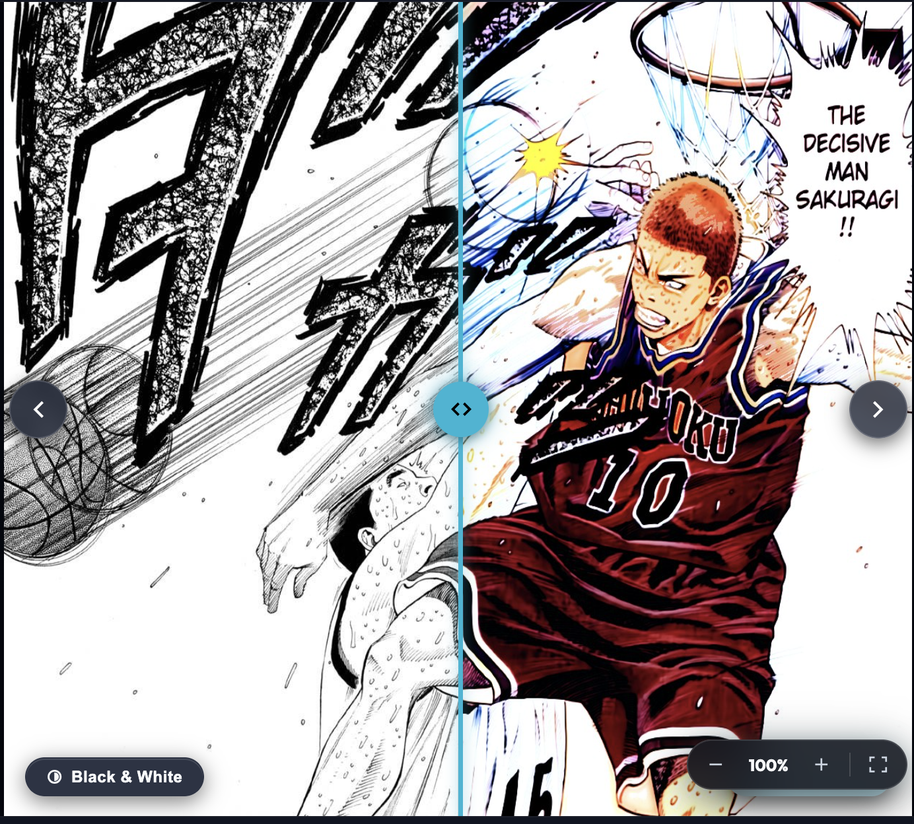
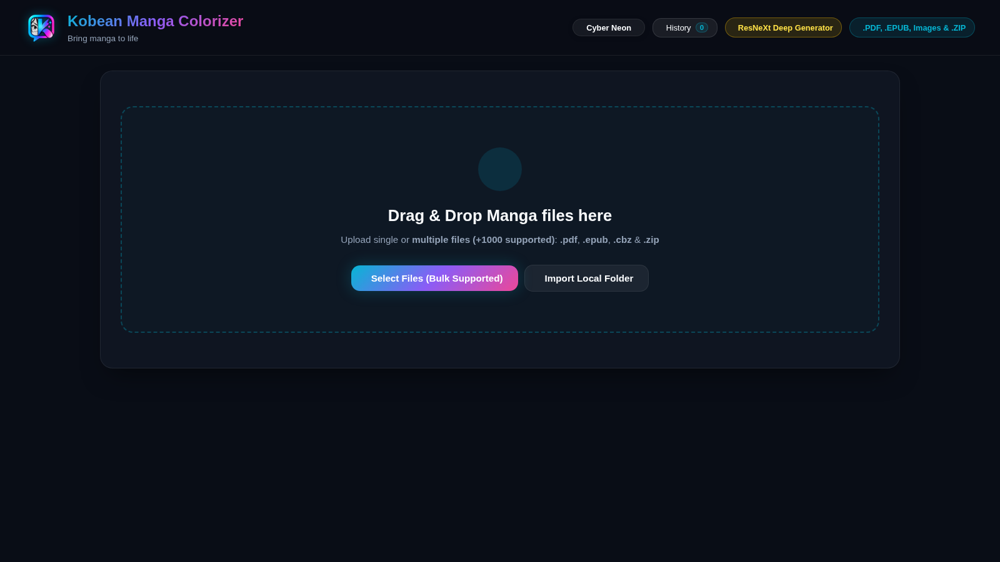
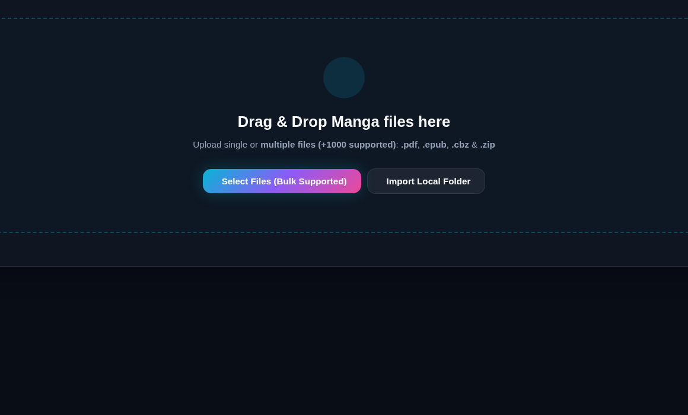
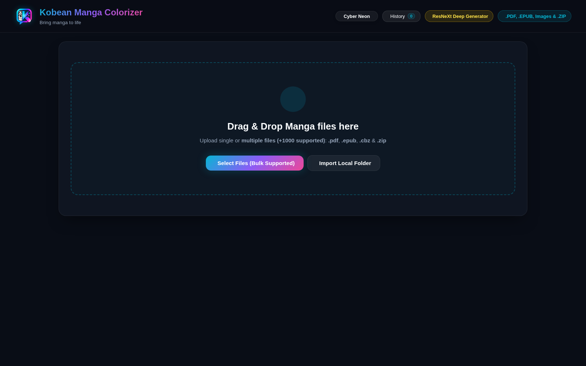
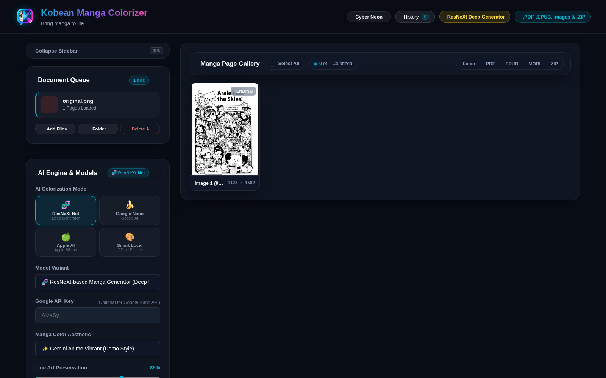
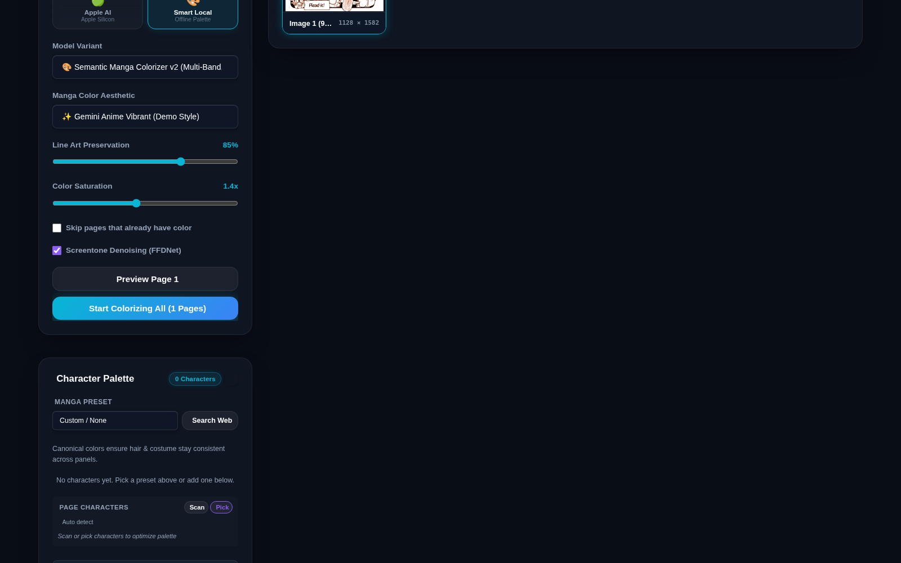
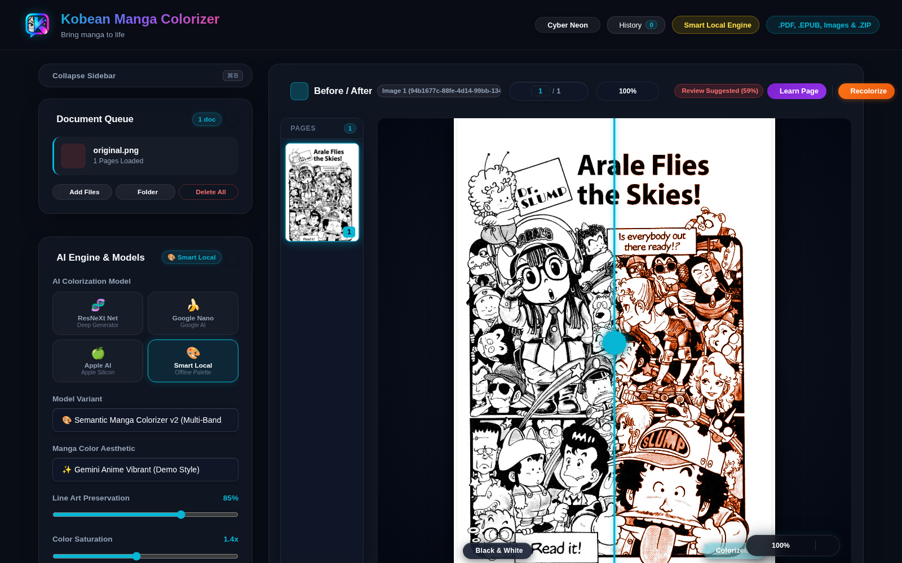

# 🎨 Kobean Manga Colorizer

<div align="center">

[](https://www.python.org/)
[](macos/)
[](https://fastapi.tiangolo.com/)
[](https://pytorch.org/)
[](https://developer.apple.com/metal/pytorch/)
[](LICENSE)

**Next-Gen AI Manga & Comic Colorization Studio (Native macOS & Web)**  
*Transform black & white manga volumes into vibrant, publication-grade full-color editions with sub-second neural inference, series character memory, speech bubble translation, and strict line-art preservation.*

[Recent Highlights](#-recent-highlights) • [Features](#-key-features) • [Native macOS App](#-native-macos-studio-app) • [Showcase](#-visual-showcase) • [Quickstart](#-quickstart) • [Model Weights](#-model-weights-generatorzip) • [Architecture](#-architecture) • [API](#-api-reference)

</div>

---

## 🔥 Recent Highlights

- **🖥️ Native macOS SwiftUI Studio App (`macos/`)**: Built a native macOS 14+ Studio application (`KobeanMangaApp` & `KobeanMangaCore`) featuring automatic Python engine supervision, a Menu Bar companion popover, macOS Keychain API key storage, 11 dark & light IDE/manga themes (*VS Code Dark+*, *VS Code Light+*, *PyCharm Darcula*, *PyCharm Light*, *Cyber Neon*, *Paper Studio*, etc.), and smooth spring hover/press micro-animations (`StudioMotion`, `StudioActionButtonStyle`, `StudioDropdownPicker`) with full **Reduce Motion** support.
- **💬 Speech Bubble OCR & Multilingual Translation**: Added automated speech bubble detection, OCR, translation (Offline/Local & Google Gemini), and clean in-bubble dialogue typesetting across multiple target languages.
- **🧬 Character Palette Memory & Series LoRA Fine-Tuning**: Added YOLO+CLIP page character recognition, per-character color swatches (hair, eyes, skin, outfit, extra), online palette lookup, confidence-gated exemplar harvesting, and `SeriesResidualAdapter` LoRA training.
- **📚 Combined E-Reader Omnibus Builder**: Assemble multi-volume queues into unified **EPUB3**, **MOBI**, or **PDF** omnibus editions with hardware presets (*Kindle Colorsoft*, *Kindle Paperwhite / Scribe*, *Kobo Libra Colour*, *iPad Retina*), volume/MB chunk splitting, and 16-level E-Ink grayscale tuning.
- **⚡ Resumable Sessions & Hardened Telemetry**: Added `/api/health` and `/api/hardware` diagnostics, SSE keepalive heartbeats, resumable single/batch colorization sessions, FFDNet screentone denoising, and background directory import queues.

---

## ✨ Key Features

### 🧠 Multi-Engine AI Architecture
- **🧬 ResNeXt-50/101 Deep Generator**: Specialized semantic manga colorization network trained on manga panels for natural skin tones, vibrant anime hair, cloth textures, and expressive eyes.
- **🍌 Google Gemini 2.0 / Nano**: Multimodal AI vision engine producing broadcast-quality anime colors, vivid skies, sound effects, and dynamic lighting.
- **🍎 Apple Silicon MPS & NVIDIA CUDA**: Native hardware acceleration delivering fast per-page colorization on Apple Silicon (M1/M2/M3/M4) and NVIDIA RTX GPUs.
- **💻 Smart Local Semantic Engine**: Ultra-fast offline heuristic colorization that runs anywhere with zero GPU requirements.

### 🎨 Series Memory, Character Palettes & Active Learning
- **Character Palette Studio**: Configure and persist character hair, eyes, skin, outfit, and accent hex colors across an entire series or search online presets.
- **YOLO + CLIP Recognition**: Scan pages to automatically identify recurring characters and bind their canonical palettes.
- **Confidence-Gated Exemplar Harvesting & LoRA**: Automatically harvest high-quality colorized pages as visual exemplars and fine-tune a lightweight `SeriesResidualAdapter` LoRA for series-consistent color grading.

### 💬 Automated Speech Bubble Translation
- **Detection & OCR**: Automatically locates speech bubbles and extracts source manga dialogue.
- **Dual Translation Engines**: Translate offline or via Google Gemini into English, Vietnamese, Japanese, Korean, Chinese, Spanish, French, German, and more.
- **Clean In-Bubble Typesetting**: Clears original text while preserving bubble borders and typesets translated dialogue cleanly inside each bubble.

### ✒️ 100% Fidelity & Clean Line Art
- **Native Multiply Blending**: Preserves 100% of original high-resolution line art, fine hatching, and screentones without chromatic blurring.
- **FFDNet Screentone Denoising**: Optional configurable pre-colorization halftone/screentone cleaning (`denoise_sigma`).
- **Speech Bubble & Margin Shield**: Intelligent luminance masking keeps page gutters, borders, and speech bubble interiors pure paper-white (`#FFFFFF`).
- **Smart Colored-Page Detection (`skip_if_colored`)**: Automatically detects and preserves native full-color covers and spreads during batch runs.

### 📚 Multi-Document Batch & E-Reader Omnibus Workflow
- **Universal Input Ingestion**: Drag & drop **PDFs**, **EPUB3**, **CBZ**, **ZIP archives**, loose **PNG/JPG/WebP** images, or entire manga folders.
- **Real-Time SSE Progress & Resumable Jobs**: Live Server-Sent Events stream page-by-page progress with pause, cancel, and resume support.
- **Interactive Split-Screen Comparator**: Live draggable before/after comparison slider with zoom (`50%`–`300%`), pan, and per-page quality score breakdowns.
- **Single, Batch & Combined Omnibus Export**: Export individual volumes or combine an entire series into **EPUB3**, **MOBI**, **PDF**, or **ZIP** optimized for Kindle Colorsoft, Kindle Paperwhite/Scribe, Kobo, and Apple Books.

---

## 🖥️ Native macOS Studio App

In addition to the web studio, Kobean Manga Colorizer ships with a native **macOS 14+ SwiftUI application** (`macos/`) powered by `KobeanMangaCore` and `KobeanMangaApp`.

### Highlights of the macOS App
- **3-Pane Editorial Workspace**: Collapsible Document Queue sidebar, interactive Split Comparator canvas + resizable Page Gallery grid, and a 3-tab Studio Inspector (*Engine*, *Palette*, *Export*).
- **11 Built-In Studio Themes**: Instant switching between classic IDE palettes (*VS Code Dark+*, *VS Code Light+*, *PyCharm Darcula*, *PyCharm Light*) and manga editorial palettes (*Cyber Neon*, *Manga Ink*, *Shonen Sunrise*, *Sakura Twilight*, *Emerald Alchemist*, *Nord Frost*, *Paper Studio*).
- **Tactile Hover & Spring Motion System**: Custom `StudioMotion` tokens, `StudioActionButtonStyle`, and native `Menu`-backed `StudioDropdownPicker` controls with specular hover sheen, accent border glow, chevron micro-motion, press compression, and automatic macOS **Reduce Motion** compliance.
- **Zero-Config Backend Supervisor**: Automatically attaches to or launches the local Python FastAPI engine and manages shutdown cleanly.
- **macOS Keychain & Menu Bar Integration**: Stores Gemini API keys securely in macOS Keychain (`KeychainHelper`) and includes a live Menu Bar status popover.

### Build, Test & Launch the macOS App

```bash
# Build and launch the native macOS Studio app bundle (dist-macos/KobeanMangaColorizer.app)
./kobean macos launch
# or: make macos

# Build the .app bundle without launching
./kobean macos build

# Package a redistributable .dmg installer
./kobean macos dmg

# Run the native Swift XCTest suite (32 unit tests)
./kobean macos test
# or directly via Swift Package Manager:
cd macos && swift test
```

---

## 🖼️ Visual Showcase

| Original Black & White Manga |                          AI-Colorized Edition                           |
| :---: |:-----------------------------------------------------------------------:|
|  |  |
| *Crisp original line art & screentones* |           *Vibrant anime palette, pure white speech bubbles*            |

### 📸 Real App Screenshots

| Studio Dashboard | Workspace & Controls |
| :---: | :---: |
|  |  |
| *Live studio home interface* | *Document workflow area with tuning controls* |

### 🧪 End-to-End Process (Real Run)

| Step 1: Upload Screen | Step 2: Original Image Imported |
| :---: | :---: |
|  |  |
| *Choose input files from local disk* | *`demo/original.png` loaded into page gallery* |

| Step 3: Colorization Running | Step 4: Colorized Result in Comparator |
| :---: | :---: |
|  |  |
| *Batch colorization started for selected page* | *Before/after split view with generated color output* |

<p align="center">
  
  <br />
  <em>Generated colorized image exported from this run.</em>
</p>

---

## ⚡ Disk Space Optimization

Manga pages rendered as uncompressed PNGs can quickly consume 3–4 GB per volume. Kobean Manga Colorizer incorporates an intelligent compression pipeline that slashes disk consumption by **~90%** with zero perceptual loss:

| Stage | Before Optimization | After Optimization | Reduction | Fidelity Impact |
| :--- | :--- | :--- | :--- | :--- |
| **PDF Page Extraction** | ~15.3 MB / page (Raw PNG) | ~1.5 MB / page (Optimized JPG) | **~90.1%** | 100% native aspect ratio & resolution |
| **Colorized Image Cache** | ~15.3 MB / page (PNG) | ~1.7 MB / page (Optimized JPG) | **~88.9%** | Pure white bubbles, vivid colors |
| **Exported PDF Volume** | ~776 MB / volume | ~78 MB / volume | **~89.9%** | Cross-reference cleaned & deflated |
| **Exported EPUB Comic** | ~776 MB / volume | ~72 MB / volume | **~90.7%** | Kindle / Apple Books / Kobo compliant |

---

## 🏗️ Architecture

```
┌──────────────────────────┐       ┌────────────────────────┐       ┌────────────────────────────┐
│  Native macOS SwiftUI    │       │  MangaFileProcessor    │       │  ColorizerEngine           │
│  & Web Studio Clients    │ ────> │  - PDF/EPUB/CBZ/Folder │ ────> │  - ResNeXt Deep Generator  │
│  - Split Comparator      │       │  - Native Aspect Ratio │       │  - Gemini 2.0 Multimodal   │
│  - 11 Studio Themes      │       │  - High-Res Extraction │       │  - FFDNet Denoising        │
└──────────────────────────┘       └────────────────────────┘       │  - Line Art Multiply       │
                                                                    │  - Series LoRA & Palettes  │
                                                                    └─────────────┬──────────────┘
                                                                                  │
┌──────────────────────────┐       ┌────────────────────────┐       ┌─────────────▼──────────────┐
│  Universal & Omnibus     │ <──── │  SSE Progress Stream   │ <──── │  MangaTranslator           │
│  Export Engine           │       │  - Live Gallery Events │       │  - Bubble Detection & OCR  │
│  - EPUB3 / MOBI / PDF    │       │  - Heartbeat Keepalive │       │  - Offline & Gemini Trans  │
│  - Kindle Colorsoft Tune │       │  - Quality Telemetry   │       │  - In-Bubble Typesetting   │
└──────────────────────────┘       └────────────────────────┘       └────────────────────────────┘
```

---

## 🚀 Quickstart

### 1. Prerequisites
- **Python 3.9+**
- **uv** (Recommended: `curl -LsSf https://astral.sh/uv/install.sh | sh` or `brew install uv`)
- *(Optional)* **macOS 14+ (Sonoma or newer)** with Xcode / Swift 5.10+ for building the native macOS Studio app.
- *(Optional)* Apple Silicon Mac (M-series) or NVIDIA GPU for hardware-accelerated inference.

### 2. Instant Setup with `kobean`

```bash
# 1. Clone the repository
git clone https://github.com/kobenguyent/kobean-manga-colorizer.git
cd kobean-manga-colorizer

# 2. One-command UV environment & alias setup
./kobean setup
```

This synchronizes `.venv` via `uv sync`, verifies model weights, activates pre-commit hooks, and installs the `kobean` CLI alias.

### 3. Model Weights (`generator.zip`)

The neural ResNeXt generator uses the pre-trained weights archive **`generator.zip`** (~129 MB). Because this file exceeds GitHub's 100 MB file limit, download it and place it in the `networks/` folder:

- 📥 **Google Drive (Direct)**: **[Download `generator.zip`](https://drive.google.com/file/d/1aIXUL1YHytRfkucujtfCPKpKyDwD_cpk/view?usp=sharing)**
- Place the downloaded file at: `networks/generator.zip`

```bash
# Verify the weights file is in place
ls -lh networks/generator.zip
```

> [!NOTE]
> If `generator.zip` is not found locally, the engine will attempt to automatically download it from HuggingFace on first launch. Downloading it directly from the Google Drive link above is recommended for faster setup.

### 4. Run the Studio (Native macOS or Web)

```bash
# Option A: Launch the Native macOS SwiftUI Studio App
kobean macos launch

# Option B: Launch the Web Studio (auto-resolves ports & opens browser)
kobean run app

# Launch Web Studio with live auto-reload (development mode)
kobean run app --reload

# Check system & hardware acceleration status
kobean status
```

> [!TIP]
> - **All CLI Commands**:
>   - `kobean macos [launch|build|dmg|test|icon]` — Build, test, package, or launch the native macOS app
>   - `kobean run app [--reload]` — Launch the web studio at `http://127.0.0.1:8000`
>   - `kobean setup` — Install/sync UV dependencies
>   - `kobean test` — Run Python unit and regression tests
>   - `kobean lint` / `kobean format` — Audit and format code with Ruff
>   - `kobean status` — Hardware, port & disk stats
>   - `kobean clean` — Clear temporary sessions, uploads, and export caches

---

## 📦 Model Weights (`generator.zip`)

| Model Asset | Size | Storage Path | Download Link |
| :--- | :--- | :--- | :--- |
| **`generator.zip`** | ~128.9 MB | `networks/generator.zip` | [Google Drive](https://drive.google.com/file/d/1aIXUL1YHytRfkucujtfCPKpKyDwD_cpk/view?usp=sharing) |
| **`extractor.pth`** | ~6.3 MB | `networks/extractor.pth` | Included in repository |
| **`net_rgb.pth`** | ~1.3 MB | `denoising/models/net_rgb.pth` | Included in repository |

---

## 🔌 API Reference

| Endpoint | Method | Description |
| :--- | :---: | :--- |
| `/api/health` | `GET` | Engine health, active task counters, and readiness probe |
| `/api/hardware` | `GET` | Hardware acceleration telemetry (MPS, CUDA, CPU, memory) |
| `/api/upload` | `POST` | Upload one or multiple manga files (PDF, EPUB, CBZ, ZIP, images) |
| `/api/import/directory` | `POST` | Recursively import a folder of manga volumes/images in the background |
| `/api/sessions` | `GET` / `DELETE` | List all uploaded sessions or clear all queued sessions |
| `/api/session/{id}` | `GET` / `DELETE` | Get session detail, page list, quality scores, or delete session |
| `/api/session/{id}/page/{idx}` | `DELETE` | Delete a single page and automatically re-index sequence |
| `/api/colorize/preview` | `POST` | Generate instant single-page preview with current tuning & palette |
| `/api/colorize/start` | `POST` | Start full or selected-page colorization for a document |
| `/api/colorize/resume/{id}` | `POST` | Resume an interrupted or partially colorized session |
| `/api/colorize/cancel/{id}` | `POST` | Cancel an active colorization job |
| `/api/colorize/batch/start` | `POST` | Start sequential batch colorization across queued volumes |
| `/api/colorize/stream/{id}` | `GET` | Server-Sent Events (SSE) live progress stream with heartbeats |
| `/api/translate/page` | `POST` | Detect, OCR, translate, and typeset speech bubbles on a single page |
| `/api/translate/session` | `POST` | Batch-translate speech bubbles across selected or all pages |
| `/api/palette/{id}` | `GET` / `DELETE` | Retrieve or reset the active character color palette for a session |
| `/api/palette/presets` | `GET` | List built-in manga character color presets |
| `/api/palette/search-online` | `POST` | Search online character color palettes for a manga series |
| `/api/series-memory/{id}` | `GET` | Retrieve Series Memory metadata, exemplars, and LoRA status |
| `/api/series-memory/learn-page` | `POST` | Harvest an approved colorized page into Series Memory exemplars |
| `/api/series-memory/{key}/train-adapter` | `POST` | Fine-tune the `SeriesResidualAdapter` LoRA on harvested exemplars |
| `/api/export/{id}` | `POST` | Build single-document export (`pdf`, `epub`, `mobi`, `zip`, `auto`) |
| `/api/export/batch` | `POST` | Build batch archive across multiple sessions |
| `/api/export/combined` | `POST` | Build combined multi-volume e-reader omnibus (`epub`, `mobi`, `pdf`) |

---

## 🧪 Testing

The repository includes both a **Python backend test suite** (`tests/`) and a **native macOS Swift XCTest suite** (`macos/Tests/`):

```bash
# Run all Python backend unit & regression tests
./kobean test
# or directly via uv:
uv run python -m unittest discover tests

# Run native macOS Swift package tests (SSE parser, models, store, themes, motion tokens)
./kobean macos test
# or directly via SwiftPM:
cd macos && swift test
```

---

## 🗺️ Roadmap

- [x] Multi-file batch upload, folder import, and concurrent queue management
- [x] ResNeXt-50/101 Generator neural colorization pipeline + FFDNet screentone denoising
- [x] Exemplar anime fusion & `SeriesResidualAdapter` LoRA active learning
- [x] Automated Speech Bubble OCR & multilingual text translation pipeline
- [x] Custom character palette memory + YOLO/CLIP character recognition
- [x] Compliant EPUB3, MOBI & deflated PDF exports + Combined E-Reader Omnibus builder
- [x] Native macOS 14+ SwiftUI Studio app with 11 themes & tactile hover/press micro-animations
- [x] 90% disk space compression optimization
- [ ] Vertical Webtoon continuous scroll reading mode

---

## 📄 License

This project is licensed under the **MIT License** — see the [LICENSE](LICENSE) file for details.

---

<div align="center">
Made with ❤️ for manga readers and comic artists worldwide. josephthien - kobenguyent
</div>
